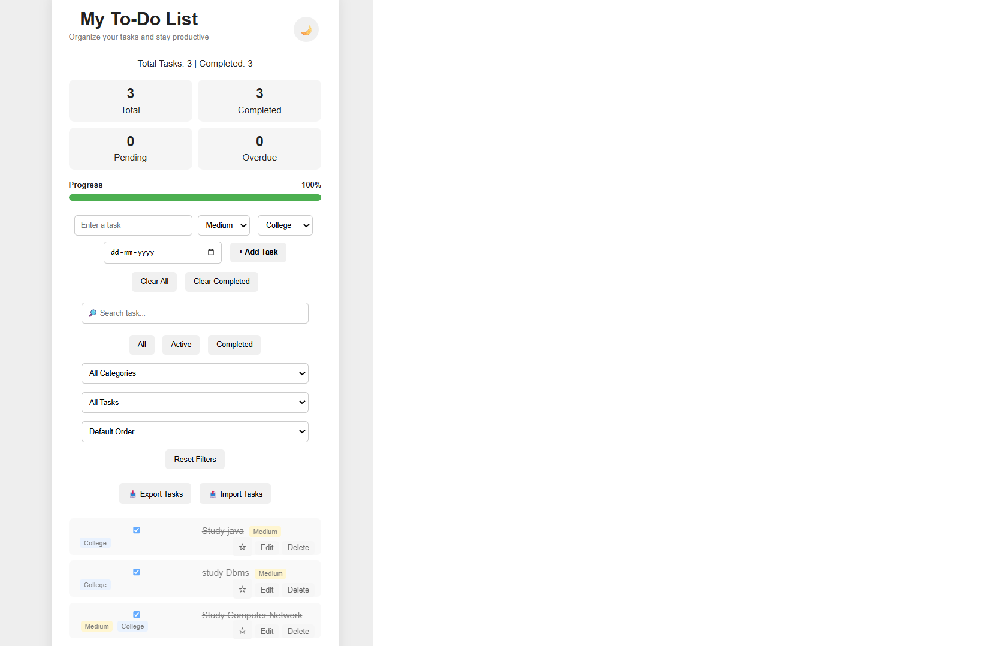

# 📝 My To-Do List
🌐 **Live Demo:** [Open My To-Do App](https://vivek-kumar50.github.io/todo-app/)
## 📸 App Preview


A simple and responsive To-Do List web application built using HTML, CSS, and JavaScript.

## 🚀 Features

- Add new tasks
- Edit tasks
- Delete tasks
- Mark tasks as completed
- Task counter
- Completed task counter
- Progress bar
- Task priorities
- Task categories
- Due dates
- Overdue task detection
- Search tasks
- Filter by status
- Filter by category
- Filter favorite tasks
- Sort by priority
- Sort by due date
- Dark mode
- Clear completed tasks
- Clear all tasks
- Export tasks
- Import tasks
- LocalStorage support
- Responsive design for mobile devices

## 🛠️ Technologies Used

- HTML5
- CSS3
- JavaScript
- LocalStorage
- Git
- GitHub

## 📂 Project Structure

```text
MyFirstApp
│
├── index.html
├── style.css
├── script.js
│
├── src
│   └── Main.java
│
├── .gitignore
└── README.md